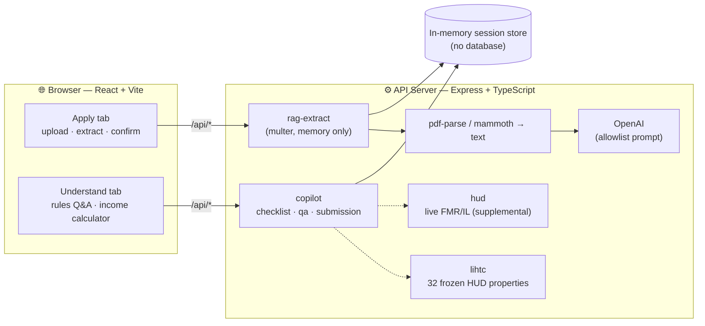

<div align="center">

# 🏠 RealDoor

**A Affordable housing-assistance platform for NYC renters —**
**rent-burden calculator, program matching, affordable listings, and a Section 8 application-readiness copilot.**

[](LICENSE)
[](package.json)
[](tsconfig.base.json)
[](pnpm-workspace.yaml)
[](docs/ARCHITECTURE_AND_RISK.md)

</div>

---

## Table of contents

- [What it does](#what-it-does)
- [How the copilot stays safe](#how-the-copilot-stays-safe)
- [Architecture](#architecture)
- [Quick start](#quick-start)
- [Environment variables](#environment-variables)
- [Project structure](#project-structure)
- [Scripts cheat sheet](#scripts-cheat-sheet)
- [Risks & mitigations](#risks--mitigations)
- [Known limits](#known-limits)
- [License](#license)

---

## What it does

Every year, hundreds of thousands of New Yorkers who qualify for housing assistance never receive it — not because the programs don't exist, but because the front door is confusing, English-only, and buried in paperwork. **RealDoor is that missing front door.**

Enter income, rent, household size, and borough, and RealDoor instantly shows:

- 💸 Whether your rent is a **burden**, and how it compares to Fair Market Rent
- 📋 Which programs you likely qualify for — **Section 8, CityFHEPS, NYC Housing Connect** lotteries, and more — in plain language, with direct links to apply
- 🔎 A searchable **program guide** and **affordable-listings** browser
- 🌐 On-demand translation into **18 languages** beyond English/Spanish

<details>
<summary><strong>💼 The application-readiness copilot (click to expand)</strong></summary>

<br>

The heart of RealDoor. Renters upload income documents; the copilot:

1. **Extracts** a small allowlisted set of fields (never SSNs, addresses, or account numbers)
2. Asks the renter to **confirm every value** before it's used
3. Answers rules questions from a **frozen, citation-backed** corpus
4. Assembles a **scored, schema-conformant** submission packet

Every number is computed **deterministically** from frozen FY 2026 HUD thresholds — the AI *locates* information; it never *decides*. Output is `READY_TO_REVIEW` or `NEEDS_REVIEW` with cited reasons, keeping a human in charge of every eligibility judgment.

</details>

## How the copilot stays safe

| Guardrail | What it does |
|---|---|
| 🚫 **No decisioning** | Refusal patterns block the model from ever stating an eligibility decision |
| 🔒 **Field allowlist** | Only 7 fields can be extracted — SSNs, addresses, bank/routing numbers are never requested |
| 🧮 **Deterministic core** | Annualization, thresholds, and readiness status are plain TypeScript, mirrored in `starter/src/calculate.py` with unit tests |
| 🛡️ **Prompt-injection guards** | Document text is treated as untrusted input; embedded instructions are ignored |
| ⏱️ **Ephemeral sessions** | In-memory only, 30-min TTL, explicit delete endpoint — no raw document text is ever stored |
| ♿ **WCAG 2.2 AA-oriented** | Accessible markup throughout the copilot flow |

## Architecture



**Deterministic core, generative edge.** The LLM only locates 7 allowlisted fields in document text — every scored computation is deterministic code, never model output. **Citations end-to-end**: every extracted field carries a page + bounding box; every rule answer carries a `rule_id`, authority tier, effective date, and source URL from an 11-rule frozen corpus.

## Quick start

> Requires **Node.js 24** and **pnpm** (the workspace refuses `npm`/`yarn` by design).

```bash
# 1. Install dependencies
pnpm install

# 2. Set required secrets (see below)
export OPENAI_API_KEY=sk-...

# 3. Run the API server
pnpm --filter @workspace/api-server run dev

# 4. In another terminal, run the frontend
pnpm --filter @workspace/housing-navigator run dev
```

<details>
<summary>Other useful commands</summary>

<br>

```bash
# Full typecheck across all packages
pnpm run typecheck

# Regenerate API hooks + Zod schemas from the OpenAPI spec
pnpm --filter @workspace/api-spec run codegen

# Run the Python starter-kit tests
cd starter && python3 -m unittest discover -s tests

# Run api-server's own test suite
pnpm --filter @workspace/api-server run test
```

</details>

## Environment variables

| Variable | Required | Purpose |
|---|:---:|---|
| `OPENAI_API_KEY` | ✅ | Copilot document extraction + rules-QA fallback |
| `PORT` | ✅ | API server / frontend dev server port |
| `BASE_PATH` | ✅ | Frontend base path (Vite) |
| `HUD_API_TOKEN` | optional | Live FMR/AMI lookups (supplemental context only — never used for scoring) |
| `LOG_LEVEL` | optional | Server log verbosity |

There is **no database** — all housing data (FMR/AMI/listings/programs) is hardcoded in [`artifacts/api-server/src/lib/housingData.ts`](artifacts/api-server/src/lib/housingData.ts), and copilot sessions live in memory with a 30-minute TTL. `lib/db` exists in the workspace but is intentionally unused.

## Project structure

<details>
<summary>Click to expand full layout</summary>

<br>

```
RealDoor/
├── artifacts/
│   ├── api-server/            # Express API — routes, HUD client, copilot data/logic
│   │   └── src/routes/        # health · housing · hud · copilot · lihtc · ragExtract · translate
│   ├── housing-navigator/     # React/Vite frontend (Home, Programs, Listings, Copilot)
│   └── mockup-sandbox/        # Design mockups / theme exploration
├── lib/
│   ├── api-spec/              # openapi.yaml — source of truth for the HTTP contract
│   ├── api-client-react/      # Orval-generated React Query hooks
│   ├── api-zod/                # Orval-generated Zod schemas
│   └── db/                    # Drizzle schema (present, currently unused)
├── starter/                   # Python starter-kit mirroring the deterministic calc logic
├── scripts/                   # Workspace tooling scripts
├── docs/
│   ├── PITCH.md                # Project pitch
│   └── ARCHITECTURE_AND_RISK.md
└── pnpm-workspace.yaml
```

</details>

## Scripts cheat sheet

| Command | What it does |
|---|---|
| `pnpm --filter @workspace/api-server run dev` | Start the API server (binds `PORT`, routes under `/api`) |
| `pnpm --filter @workspace/housing-navigator run dev` | Start the frontend (Vite) |
| `pnpm run typecheck` | Typecheck every package in the workspace |
| `pnpm --filter @workspace/api-spec run codegen` | Regenerate API hooks/schemas from `lib/api-spec/openapi.yaml` |
| `pnpm run build` | Typecheck + build all packages |

## Risks & mitigations

<details>
<summary>Full risk table (from <code>docs/ARCHITECTURE_AND_RISK.md</code>)</summary>

<br>

| Risk | Mitigation |
|---|---|
| Model invents an eligibility decision | Decision-pattern refusal (`CH-DECISION-001`); readiness is computed, not generated |
| Prompt injection via document text | Injection patterns refused; extraction prompt allowlists 7 fields; raw text never stored |
| PII overcollection | No SSN/address/account fields extracted; in-memory-only uploads; session delete endpoint |
| Protected-trait inference | Refusal patterns (`CH-SAFETY-001`); no such fields in the schema |
| Stale/wrong-year limits | Frozen FY 2026 constants; wrong-year questions get an explicit refusal citing effective dates |
| Vacancy misinformation | LIHTC data labeled "availability unknown" per `HUD-DATA-001` |
| Expired evidence | 60-day currency convention (`CH-CURRENCY-001`) enforced against the frozen challenge date |
| Hallucinated extraction values | Confidence levels + source snippets shown; renter must confirm/edit every field before use |

</details>

## Known limits

- **In-memory sessions** — a restart clears state (fine for this simulation; a real deployment needs encrypted persistence + a retention policy)
- **Page-level citations** — bounding boxes are page-level when exact word geometry isn't available
- **Live HUD data is supplemental only** — clearly labeled, never used for scoring

## License

[MIT](LICENSE) © 2026 D0CT4
